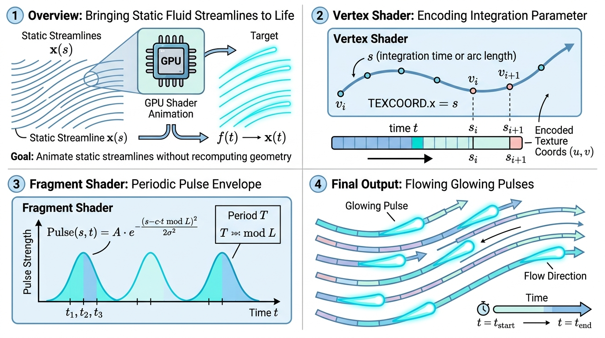

# Animated Streamline Representation

Display 下拉 **`Animated Streamline`**。不要构造 representation proxy。Python：`Representation = 'Animated Streamline'`，属性 **`AS_*`**（`disp.AS_Animate`、`AS_TimeSource`、`AS_FrameRate`、`AS_FrameCount`、`AS_TimeScale`、`AS_IntegrationScale`、`AS_OpacityScale`、`AS_Trunc`、`AS_Pow`、`AS_Randomize`、`AS_RandomizeScale`、`AS_AnimationCoordinateArray`、`AS_AnimationCoordinateYArray`）。

## 示意图



## 1. 目的与功能算法详细解释

### 🎯 核心目的
在科学可视化中，展示流体（如风场、水流）的运动轨迹通常需要重构流线的几何顶点来生成动画，这会带来较高的 CPU 与内存开销。本模块的目的在于**通过纯 GPU 着色器 (Shader) 技术，在静态几何体上实现高效且逼真的流体动画效果**，从而显著提升渲染性能。

### 🧠 算法原理解析
其核心机制依赖于 `vtkAnimatedStreamlineCompositePolyDataMapper` 和自定义的 GLSL 着色器替换 (Shader Replacements)：
1. **数据准备 (CPU 端)**：自动获取数据中的积分时间（`IntegrationTime`）等标量数组，并将其映射到顶点的纹理坐标（`tcoord.x` 和 `tcoord.y`）中。若未找到指定标量，则使用顶点沿流线的弧长 (Arc Length) 作为替代。
2. **顶点着色器 (Vertex Shader)**：提取纹理坐标，并传递给片段着色器。
3. **片段着色器 (Fragment Shader)**：利用公式计算出一个周期性的脉冲值 (Pulse)：
   ```glsl
   float mixValue = animCoordx * integrationScale + time * timeScale / animCoordy;
   float phase = fract(mixValue); // 取小数部分，实现循环动画
   float pulse = 1.0 - pow(clamp(truncValue * phase, 0.0, 1.0), powValue);
   ```
   随后，将计算得到的 `pulse` 与颜色的 Alpha（透明度）通道相乘。此操作能够使流线的局部区域变亮并呈现带拖尾的衰减效果，在时间变量 `time` 的驱动下形成流动的动画视觉体验。

---

## 2. 参数列表及其效果和含义

以下是控制流线动画表现的主要参数：

* **`TimeSource` (int, 枚举)**
  * **含义**：着色器时间项 `time` 的来源（默认 `0` = Real time）。
  * **`0` Real time (wall clock)**：`time = 墙钟秒数 - 创建时刻`。每渲染一帧，相位推进量等于**上一帧实际耗时**，所以渲染耗时抖动会直接变成脉冲速度抖动；同一帧渲染两次相位也不同。交互观看没问题，**导出序列图片时上下帧不连续**。
  * **`1` Render frames (image sequence)**：`time = FrameCount / FrameRate`，计数器**每渲染一帧 +1**（`Animate` 关时不加）。每帧固定推进 `1/FrameRate` 秒对应的相位，与单帧渲染耗时无关，因此 **Save Animation / 逐帧 Save Screenshot 导出的序列是连续的**，而且可以复现。**切到该模式的瞬间计数器归 0**，所以每次导出的第 0 帧相位一致；导出前把 `FrameCount` 设 0 也能达到同样效果。
  * **注意**：该模式跟着"渲染次数"走，所以交互时播放速度取决于实际帧率（机器越快脉冲越快）；导出时渲染次数 = 输出帧数，不受影响。
* **`FrameRate` (double)**
  * **含义**：Render frames 模式下把帧号换算成秒的帧率（默认 `30`，范围 1～240）。
  * **效果**：设成序列将来**播放**用的帧率，脉冲速度就与 Real time 模式下相同；想整体放慢/加快直接用 `TimeScale`。
* **`FrameCount` (int)**
  * **含义**：Render frames 模式用的渲染帧计数器（默认 `0`）。
  * **效果**：只想从确定的相位开始导出时把它设 0；也可以用 Python 直接指定某一帧，例如 `disp.AS_FrameCount = 120`。属性面板里显示的值只在属性更新时刷新，可能落后于实时计数器。
* **`Animate` (bool)**
  * **含义**：动画总开关。
  * **效果**：设为 `true` 时启用动画渲染，设为 `false` 则保持静态展示。
* **`OpacityScale` (double)** 
  * **含义**：整体不透明度缩放（默认 `0.8`）。
  * **效果**：控制动画高亮部分的透明度。可适当调低以避免视觉过于强烈。
* **`TimeScale` (double)** 
  * **含义**：时间缩放系数（默认 `0.4`）。
  * **效果**：调节流动**速度**。值越大，动画演进速度越快。
* **`IntegrationScale` (double)** 
  * **含义**：空间积分缩放系数。建议默认约为 `100 / (L_max × V_max)`（约 100 个脉冲）。
  * **效果**：调节脉冲在空间上的**密集程度**（频率）。值越大，同一条流线上同时出现的脉冲高亮区域越多。
  * **默认 / Reset**：ParaView 自定义 Domain 用输入包围盒**最长边** `L_max` 与点数据最大速度幅值 `V_max` 近似 `animCoordx` 的 Δx，建议值 `num_pulses / (L_max × V_max)`（`num_pulses=100`）。属性旁 **Scale/Reset** 可刷新回该建议值；无速度数组时按 `V_max=1` 回退。
* **`Trunc` (double)** 
  * **含义**：截断阈值（默认 `2.0`）。
  * **效果**：控制脉冲的**有效长度**。它是对相位进行的乘积截断，值越大，发光部分占整体周期的比例越小，脉冲视觉上更短、更锐利。
* **`Pow` (double)** 
  * **含义**：衰减指数（默认 `1.0`）。
  * **效果**：控制动画拖尾的**消散曲线**。值大于 1 会使透明度非线性快速衰减，值小于 1 则产生更平滑的拖尾过渡。
* **`Randomize` (bool)** 
  * **含义**：逐流线随机相位开关（默认 `false`）。
  * **效果**：种子点排成一条线或一个平面时，各条流线在 `animCoordx` 上的取值几乎同步，脉冲会像**层叠的片状**一起推进。打开后，**每条连通流线（polyline，或包在它外面的 tube 表面）**在写入 `tcoord.x` 时额外加一个随机的相位偏移，同一组件内所有点共用同一个随机数，因此单条流线上的脉冲仍连续，不同流线之间错开。
  * **注意**：偏移是烘进 `tcoord.x` 的（不新增顶点属性），所以需要 **`AnimationCoordinateArray` 指向的数组存在**；走弧长回退（没有该数组）时不起作用。随机数由连通分量的锚点（点号最小的那个点）坐标做确定性哈希得到，拖滑块或重建纹理坐标时图案不会变；用 `Tube`/`StreamTracer` 生成的网格同样按连通分量分组，一个管套一条线时不会逐三角形乱跳；`MultiBlock`/PDC 每个 block 各一条流线时也会拿到不同相位。
* **`RandomizeScale` (double)** 
  * **含义**：随机相位的幅度，单位是**脉冲周期**（默认 `1.0`）。
  * **效果**：偏移量取 `[0, RandomizeScale)` 个周期，再除以 `IntegrationScale` 换算成 `tcoord.x` 的单位。`0` 等于关闭；`1` 时每条流线的相位在整周期内均匀随机，完全打散；大于 `1` 视觉效果基本不变（只有小数部分参与相位），所以一般用 `0`～`1` 之间做轻微错开。
* **`AnimationCoordinateArray` (string)** 
  * **含义**：主动画坐标绑定的数据列名（默认 `"IntegrationTime"`）。
  * **效果**：指定用于驱动 Shader 动画演化的物理量数组，通常为流线的积分时间。
* **`AnimationCoordinateYArray` (string)** 
  * **含义**：可选的副动画坐标数组名。
  * **效果**：在 Shader 中作为时间项的除数 (`time * timeScale / animCoordy`)。该参数支持基于局部标量场（如局部流速）实现非均匀的动画演进效果。